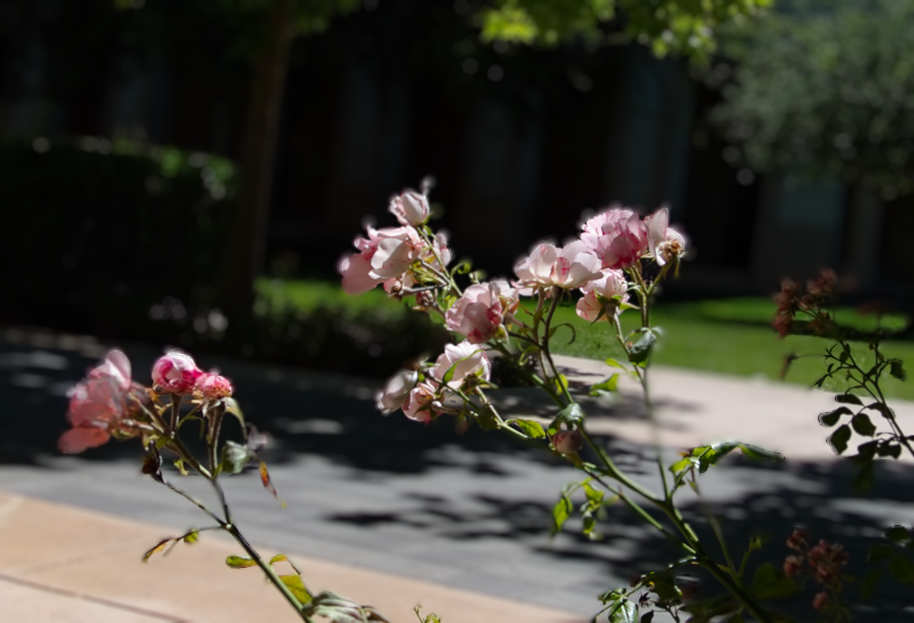
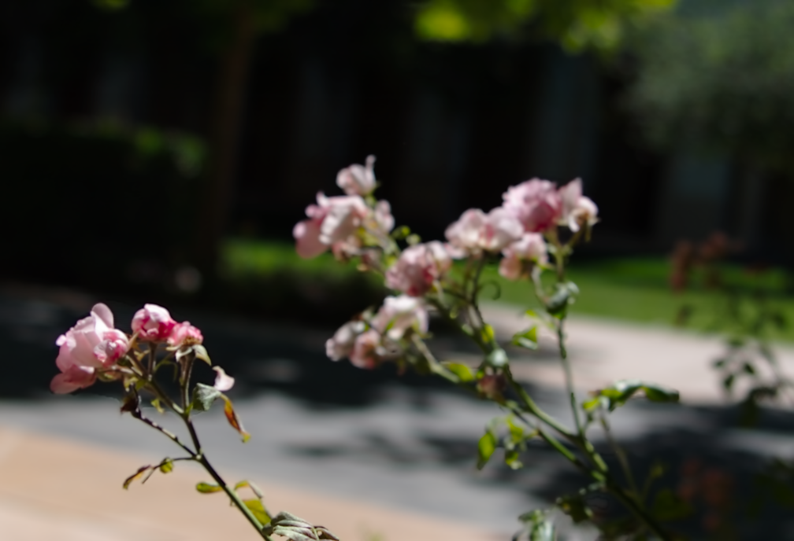
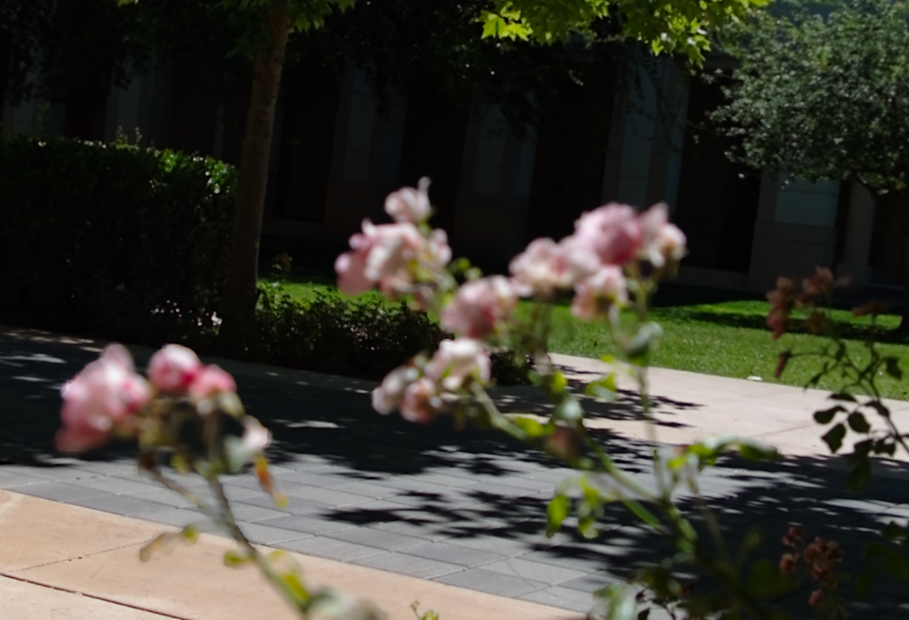
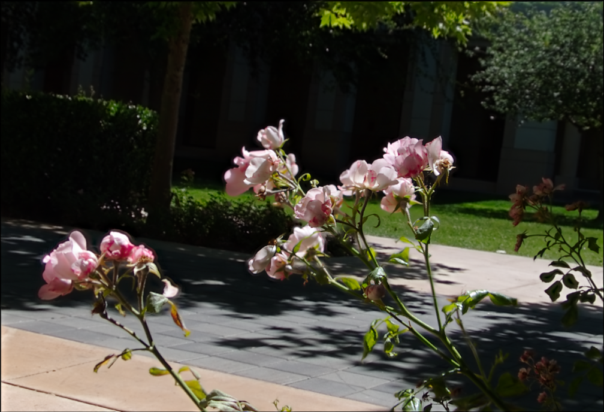

# BRnFS — Bokeh Rendering & Focus Stacking

Control depth of field in two directions: render shallow-focus bokeh from a
single photograph, or combine a focus bracket into an all-in-focus image.
BRnFS brings both workflows into one desktop GUI and command-line interface.

[Setup & usage](docs/setup.md) · [Architecture](docs/architecture.md) · [Third-party sources](THIRD_PARTY_NOTICES.md)

## Results

### Bokeh rendering

Keep the subject in focus while defocusing the surrounding scene. The renderer
uses estimated disparity, foreground separation, and an inpainted background
to account for occlusion near object boundaries.

<table align="center">
  <tr>
    <th align="center">All-sharp input</th>
    <th align="center">Rendered bokeh</th>
  </tr>
  <tr>
    <td align="center">
      
    </td>
    <td align="center">
      
    </td>
  </tr>
</table>

Example settings: `--k-blur 30 --focal 0.10 --lens 71 --gamma 2.2`.
The focal value uses normalized disparity coordinates.

### Focus stacking

Combine sharp regions from photographs focused at different depths. Three
representative inputs are shown below; the fused output uses all 15 frames in
the included stack.

<table align="center">
  <tr>
    <th align="center">Near focus</th>
    <th align="center">Middle focus</th>
    <th align="center">Far focus</th>
    <th align="center">Fused output</th>
  </tr>
  <tr>
    <td align="center">
      
    </td>
    <td align="center">
      
    </td>
    <td align="center">
      
    </td>
    <td align="center">
      
    </td>
  </tr>
</table>

Example settings: `--levels 3 --mask soft --top mean --sharpness Tenengrad+Blur`.

For a walkthrough of both GUI workflows, watch the
[full project demo](https://youtu.be/h5yaBS06S4U).

## Features

- **Unified GUI and CLI:** a two-tab Tkinter interface with source/result
  previews and saving, plus `python -m brnfs` commands for both workflows.
- **Controllable bokeh:** adjust blur strength, focal plane, and lens kernel
  size. Cached scene preprocessing supports repeated renders; a focus overlay
  helps select the focal region before pressing **Render**.
- **Configurable focus fusion:** affine ECC alignment, Laplacian pyramids,
  six sharpness measures, hard or soft selection masks, and mean or maximum
  fusion of the coarsest level. Aligned stacks are cached for reuse.

## Getting started

The full application targets **Python 3.9**. Bokeh rendering uses pretrained
models and the CUDA scatter extension; provide an NVIDIA GPU, CUDA Toolkit
11.7, and a compatible C++ compiler. The GUI also requires Tcl/Tk and a
graphical desktop. Focus stacking can run on CPU.

On Linux or WSL2:

```bash
git clone https://github.com/ljc-1222/bokeh-rendering-focus-stacking-suite.git
cd bokeh-rendering-focus-stacking-suite
PYTHON_BIN=python3.9 bash setup.sh
source .venv/bin/activate
python -m brnfs gui
```

For [Windows](docs/setup.md#windows-powershell),
[a minimal CPU-only focus environment](docs/setup.md#focus-stacking-on-cpu),
model downloads, and troubleshooting, see [Setup & usage](docs/setup.md).

After installation, run the included examples from the repository root:

**Bokeh rendering**

```bash
python -m brnfs bokeh \
  --rgb examples/bokeh/IMG_2649.png \
  --output outputs/bokeh/IMG_2649_bokeh.png \
  --k-blur 30 --focal 0.10 --lens 71 --gamma 2.2
```

**Focus stacking**

```bash
python -m brnfs focus \
  --dataset examples/focus/IMG_2649 \
  --output outputs/focus/IMG_2649_fused.png \
  --levels 3 --mask soft --top mean --sharpness Tenengrad+Blur
```

Both commands save to the specified output path. See the
[command reference](docs/setup.md#command-line-reference) for all options.

## Implementation and credits

The bokeh pipeline builds on [Dr.Bokeh](https://github.com/ShengCN/DrBokeh-Src),
including its layered scatter renderer, CUDA kernels, and integration of DPT,
LDF, and LaMa. BRnFS combines this rendering pipeline with a configurable focus
stacking implementation, shared GUI/CLI entry points, preprocessing caches,
and bundled examples.

[Architecture](docs/architecture.md) explains the processing stages and module
layout. The [third-party notices](THIRD_PARTY_NOTICES.md) document records
upstream sources and license information.

**Authors:** Jin-Cheng Lin and Hsin-Chang Tsai · Department of Electrical
Engineering, National Tsing Hua University · EE3662 Digital Signal Processing
Laboratory final project.
