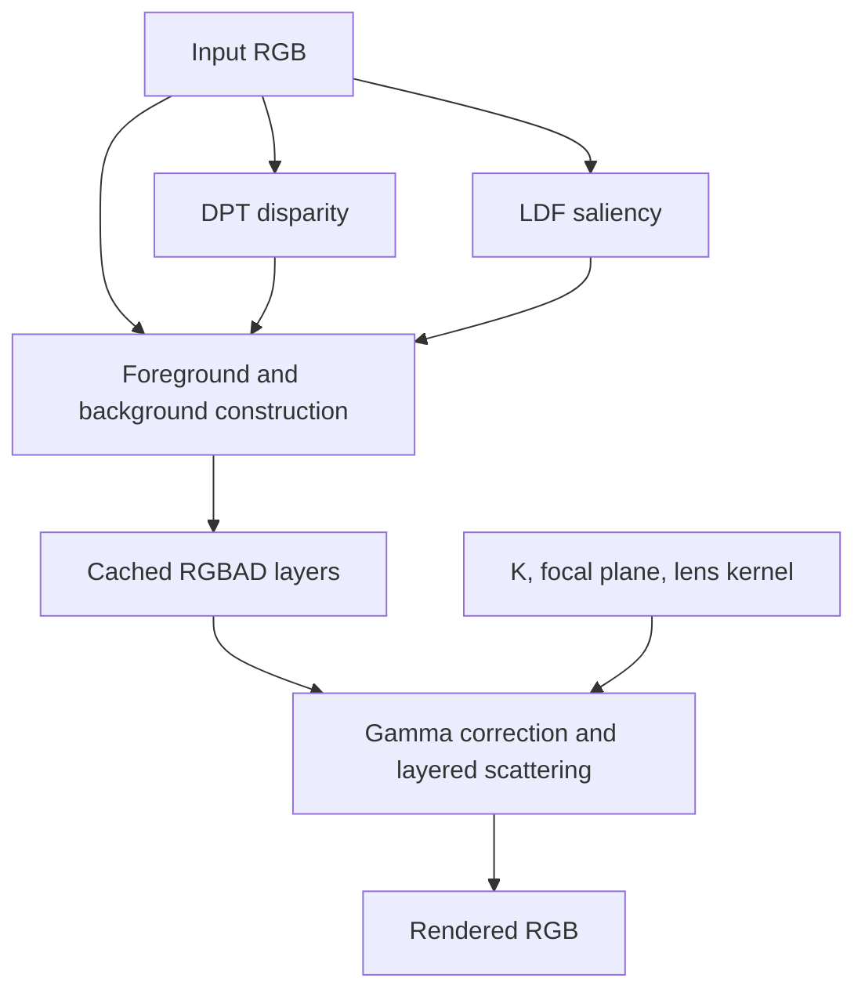
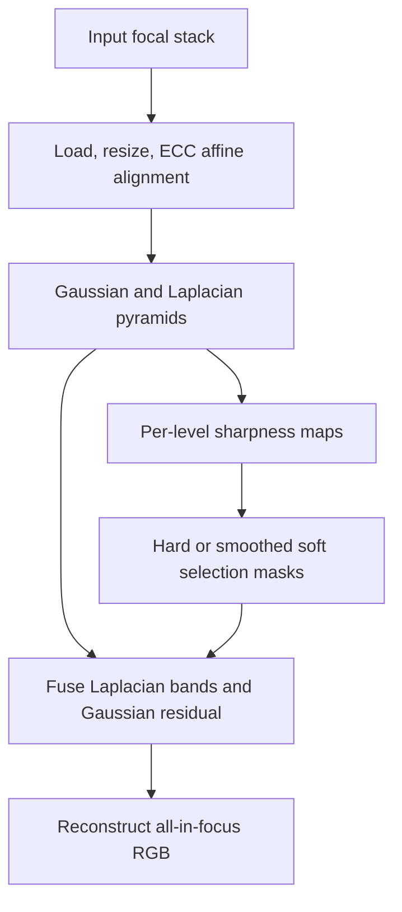

# Architecture

BRnFS exposes two independent workflows through `python -m brnfs` and a two-tab
Tkinter GUI. Bokeh rendering takes a single RGB image and synthesizes shallow
depth of field. Focus stacking combines multiple focal settings into an
all-in-focus image. Each workflow accepts its own inputs and writes a separate
output.

The CLI and GUI share the algorithm modules. The bokeh interface uses
`BokehEngine`; the focus CLI uses `run_focus_stacking`, while the focus GUI calls
the same preprocessing, pyramid, sharpness, and fusion functions directly.
See [Setup](setup.md) for environment requirements and the
[README](../README.md#results) for example outputs.

## Bokeh rendering

**Preprocessing.** DPT estimates disparity from the input RGB image. Its output
is resized to the input dimensions and normalized to `[0, 1]`; the focal-plane
parameter uses this relative disparity scale, not a distance in meters. LDF
(Label Decoupling Framework) predicts a saliency map used as a foreground alpha
estimate. The CLI can instead load an RGBA image through `--alpha` and a
disparity `.npz` containing a `data` array through `--disp`.

The layer builder uses the saliency mask to construct two RGBAD arrays, each
containing RGB, alpha, and disparity:

| Layer | RGB | Alpha | Disparity |
|---|---|---|---|
| Foreground | Input RGB | Predicted or supplied saliency/alpha map | Telea inpainting extends foreground disparity around its boundary. |
| Background | LaMa fills the region behind the foreground. | One throughout the layer | LaMa fills masked disparity after replicating it into three channels; the first output channel is retained. |

Thresholding and dilation define the inpainting regions. Fully automatic
preprocessing is cached under `outputs/cache/bokeh/`, allowing subsequent renders
to reuse the estimated maps and layers. Runs with supplied alpha or disparity
do not reuse or write this automatic cache.

**Rendering.** Gamma correction is applied to the RGB channels of the prepared
layers before scattering, then inverted on the rendered image. The renderer
subtracts the focal-plane value from disparity, applies depth-dependent
scattering within the lens kernel, and composites the foreground and background
with occlusion-aware weights. `K` controls blur strength; `lens` sets the odd
kernel size and therefore the neighborhood searched. The implemented aperture
mask is circular.

The scattering formulation and C++/CUDA kernels come from
[Dr.Bokeh](https://github.com/ShengCN/DrBokeh-Src). `scatter_cuda` is the practical
rendering backend; a slow Python/PyTorch CPU reference remains available as a
fallback. This suite uses the renderer for inference.

**Interaction and intermediate outputs.** The bokeh GUI exposes `K`, focal plane,
and lens kernel size. After preprocessing, adjusting K or the focal plane can
update a focus overlay on the source preview. A full bokeh image is generated when
the user presses **Render**, and saved separately with **Save rendered image**.
The GUI displays the source and rendered result. To inspect intermediate maps,
use the CLI's `--verbose` option: it exports disparity, alpha, and each layer's
RGB, alpha, and disparity alongside the final output. `--gamma` is also a CLI
option.

## Focus stacking

The focus workflow operates on same-size PNG images from one directory, loaded
in filename order. It uses NumPy and OpenCV and does not require bokeh model
weights or CUDA.

1. **Align the stack.** ECC estimates an affine warp from each frame to the first
   frame. If registration fails, the implementation prints a warning and keeps
   that frame unchanged. Aligned stacks are cached under `outputs/cache/focus/`.
2. **Build pyramids.** Each frame is decomposed into Laplacian bands and a
   coarsest Gaussian residual. `levels=3` produces three Laplacian bands and one
   residual.
3. **Compute sharpness and masks.** One of six sharpness definitions is applied
   to each color channel of every Laplacian band. Hard masks select the maximum
   response across source images. Soft masks smooth those selections with a
   7 × 7 Gaussian kernel (`sigma=1.2`) and normalize across sources. The
   `hard-min` option deliberately selects the minimum response for comparison.
4. **Fuse and reconstruct.** Masks weight the Laplacian bands. The coarsest
   Gaussian residual is fused by either mean or maximum. Successive upsampling
   and addition reconstruct the final image, which is clipped to `[0, 255]`.

Here, $L$ denotes a Laplacian band and $G$ a 3 × 3 Gaussian blur:

| Sharpness option | Response |
|---|---|
| `L` | Absolute magnitude, $\lvert L\rvert$ |
| `GaussianBlur(L)` | Smoothed absolute magnitude, $G(\lvert L\rvert)$ |
| `GaussianBlur(L^2)` | Smoothed squared response, $G(L^2)$ |
| `Tenengrad+Blur` | Smoothed squared Sobel-gradient magnitude of `L` |
| `Variance(L)` | Local variance, $G(L^2) - G(L)^2$, clamped to zero |
| `SML+Blur` | Smoothed sum of absolute horizontal and vertical second differences |

The default settings are `Tenengrad+Blur`, soft masks, mean residual fusion,
and three pyramid levels.
The GUI exposes these choices and provides source/result previews and saving.

Registration and fusion assume a static scene. Subject motion or unsuccessful
alignment can introduce ghosting; inaccurate sharpness masks can leave blurred
regions or seams.

## Code and data map

| Location | Responsibility |
|---|---|
| `brnfs/cli.py`, `brnfs/ui/` | Command parsing, GUI tabs, previews, and saving |
| `brnfs/paths.py` | Checkout-relative input, model, output, and cache locations |
| `brnfs/focus/runner.py`, `app/focus_stacking/` | Focus CLI orchestration and shared alignment, pyramids, masks, fusion, and evaluation |
| `app/bokeh_rendering/gui_engine.py` | Bokeh preprocessing cache and rendering API |
| `app/bokeh_rendering/` | Layer construction, model adapters, DScatter, and vendored DPT, LDF, and LaMa code |
| `brnfs/cuda_src/` | Dr.Bokeh C++/CUDA extension sources and build entry point |
| `examples/bokeh/`, `examples/focus/` | Included single-image and focal-stack inputs |
| `models/dpt/`, `models/ldf/`, `models/lama/` | Bokeh model weights |
| `outputs/bokeh/`, `outputs/focus/`, `outputs/cache/` | Generated results and reusable preprocessing artifacts |
| `docs/assets/readme/` | Committed images displayed in the README |

Model adapters and third-party code retain their upstream directory layouts
inside `app/bokeh_rendering/`. See
[Third-party notices](../THIRD_PARTY_NOTICES.md) for their sources and licensing
status.

