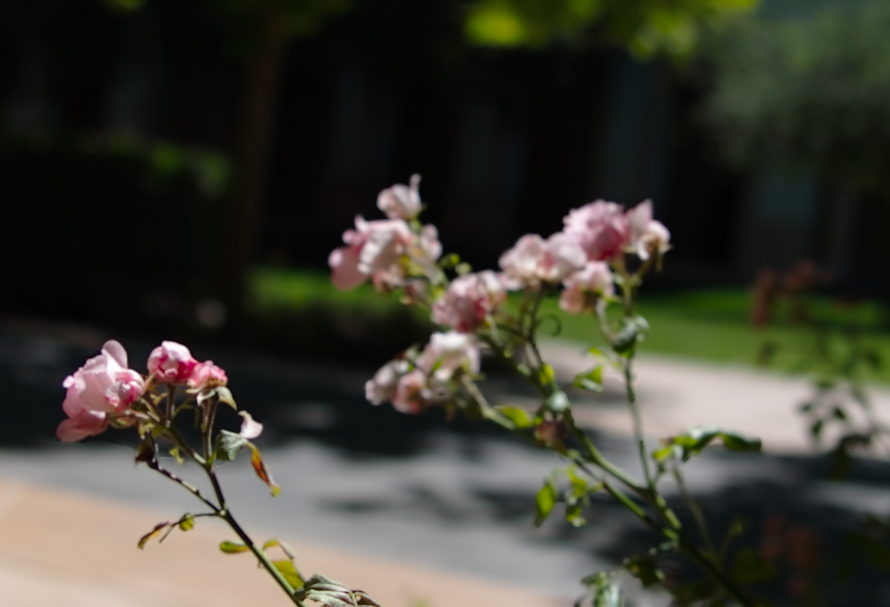
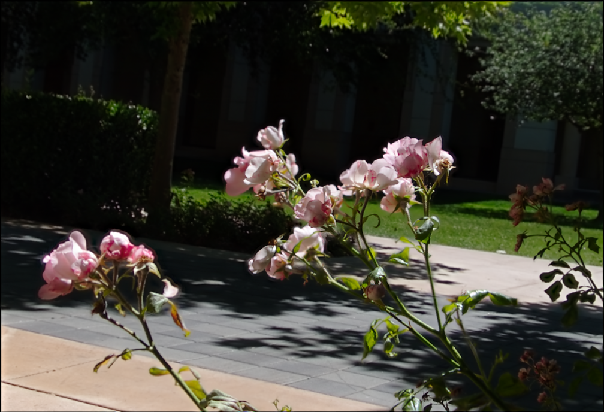
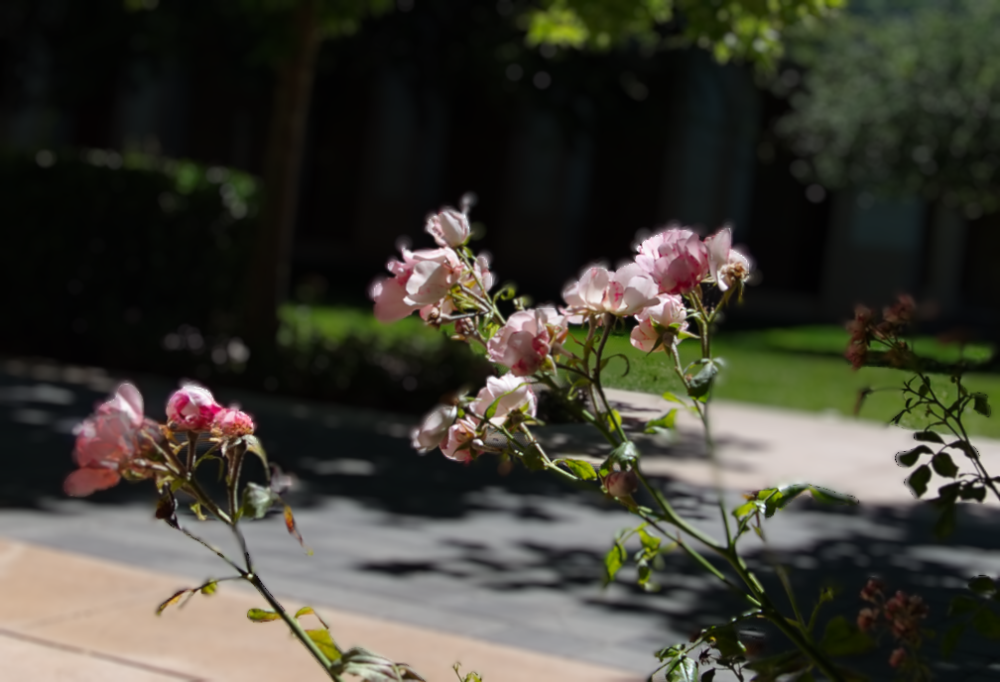

# Results and Evaluation

BRnFS demonstrates two complementary depth-of-field operations: rendering
synthetic bokeh from one image and combining a focus stack into an all-in-focus
image. The numerical results below are recorded results from the **original
project evaluation**. The included examples provide a smaller, runnable view of
the two workflows.

## Focus Stacking Experiments

The original evaluation used **791 image stacks** and **24 configurations**:
six sharpness definitions, two mask types (`soft` and `hard`), and two rules for
the coarsest Gaussian level (`mean` and `max`). Quality was measured using the
multi-source `Q_AB/F` implementation described below; higher scores indicate
better preservation of the selected source edges.

The highest recorded mean was **0.8854 ± 0.0057** for
**Tenengrad+Blur / soft / mean**. All `±` values on this page are the recorded
95% confidence-interval half-widths.

The following table isolates the main effect of sharpness by averaging over
both mask types and both top-level rules. These averages describe groups of
configurations, so they should be compared within this table.

| Sharpness definition | Mean Q_AB/F ± 95% CI |
| --- | ---: |
| `L` | 0.8017 ± 0.0049 |
| `GaussianBlur(L)` | 0.8567 ± 0.0056 |
| `GaussianBlur(L^2)` | 0.8644 ± 0.0057 |
| `Tenengrad+Blur` | 0.8823 ± 0.0057 |
| `Variance(L)` | 0.8707 ± 0.0060 |
| `SML+Blur` | 0.8715 ± 0.0064 |

Paired comparisons quantify changes on the same stacks. For the mask and
top-level comparisons, results were averaged over the other configuration
choices.

| Comparison | Paired improvement in Q_AB/F ± 95% CI | Stacks improved |
| --- | ---: | ---: |
| `Tenengrad+Blur` vs. `L`, with `soft / mean` fixed | +0.0725 ± 0.0015 | 98.5% |
| `soft` vs. `hard` masks | +0.0106 ± 0.0005 | 98.0% |
| `mean` vs. `max` top-level fusion | +0.0007 ± 0.0002 | 65.1% |

Under the original protocol, sharpness choice produced the largest differences,
soft masks usually improved the result, and the top-level rule had a smaller
effect. The `0.8017` main-effect average for `L` is not the score of the specific
`L / soft / mean` baseline used in the first paired comparison.

A separate pyramid-depth study showed a strong increase in mean quality from
one to three levels, followed by a plateau. This observation motivated the
current three-level default. The available results do not include measured
runtime curves, so the depth choice is supported here by quality saturation.

## How to Interpret Q_AB/F

The [evaluation implementation](../app/focus_stacking/evaluation.py) measures
edge-strength and edge-orientation preservation. For more than two source
images, it extends the two-source metric by choosing the two highest-scoring
sources **at each pixel**, using supplied sharpness maps, then aggregating their
edge-preservation scores with edge-strength weights.

The [focus-stacking GUI](../brnfs/ui/focus_stacking.py) supplies the finest-level
sharpness maps produced by the selected fusion configuration. Consequently,
changing the sharpness definition changes both the fused image and the sources
used to evaluate it. The cross-sharpness ranking above is therefore specific to
this evaluation protocol. With the input stack, preprocessing, and sharpness
definition held fixed, mask and top-level comparisons retain the same selected
source references.

A comparison intended to isolate sharpness choice should select evaluation
sources with one fixed rule shared by all candidates. That would constitute a
separate evaluation; the historical numbers above belong to the original rule.
`Q_AB/F` measures edge preservation and does not by itself establish perceptual
quality across all scenes.

## Visual Demonstrations

The checked-in images show the included `IMG_2649` example. Focus stacking uses
the full 15-image stack; the three source previews in the
[README](../README.md) are selected frames from that stack.

| Example source frame | Fused output |
| --- | --- |
|  |  |

Bokeh evaluation was qualitative. The original parameter sweep varied blur
strength and focal disparity to show increasing defocus and movement of the
in-focus region. The example below shows one saved setting. Its quality depends
on the estimated disparity, foreground separation, background inpainting, and
layered rendering; errors in these intermediate signals can appear at object
boundaries.

| Input image | Rendered bokeh |
| --- | --- |
|  |  |

## Reproduction Scope

The repository currently contains one example focus stack and its associated
bokeh input. The complete 791-stack manifest, dataset provenance, per-stack
results, batch evaluation runner, and confidence-interval calculation procedure
are not included. Reconstructing the original tables requires those materials,
including the exact preprocessing settings and rules for failures and ties.

After [installation](setup.md), regenerate both demo workflows from the
repository root in the full environment:

```bash
python -m brnfs demo-assets --output outputs/demo-assets
```

Add `--focus-only` when using the minimal CPU environment. Practical bokeh
rendering requires the model weights and CUDA renderer. Each run writes its
outcome to `outputs/demo-assets/demo_status.md`; inspect it for skipped or failed
steps. The [committed asset notes](assets/readme/demo_status.md) identify the
source frames used for the showcase. These commands regenerate example images.
The focus GUI also displays a `Q_AB/F` score for the selected example;
the [CLI focus runner](../brnfs/focus/runner.py) writes the fused image without
calculating a score.
